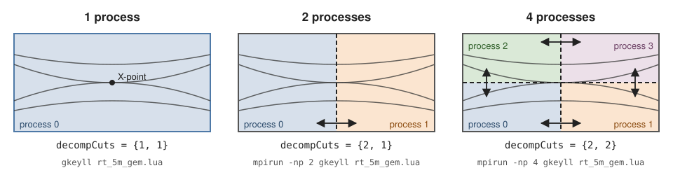
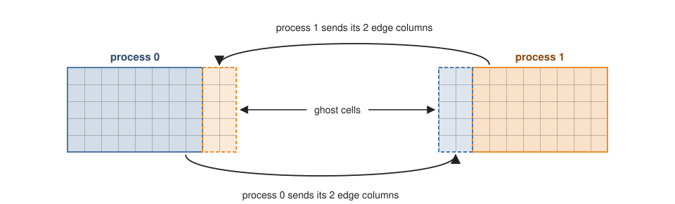

# Running the simulations {.unnumbered}

The lectures analyze two simulations of the
[GEM reconnection problem](https://doi.org/10.1029/1999JA900449) with an
ion-to-electron mass ratio of 100: one with the five-moment (5m) two-fluid
equations and one with the ten-moment (10m) equations. This chapter runs both
on your laptop, using several of its cores at once, and puts the output where
the lecture notebooks look for it.

| Simulation | Input file | Model |
|------------|------------|-------|
| `5m_gem_mass100` | [`rt_5m_gem.lua`](https://github.com/JunoRavin/reconnection-lectures/blob/main/inputs/rt_5m_gem.lua) | Five-moment two-fluid |
| `10m_gem_mass100` | [`rt_10m_gem.lua`](https://github.com/JunoRavin/reconnection-lectures/blob/main/inputs/rt_10m_gem.lua) | Ten-moment two-fluid |

As in the installation chapter, each command block starts with a `cd` into
the folder it needs, so run the whole block.

## 1. Set up the run folders

Gkeyll writes its output into the folder you start it from. The notebooks look
for each simulation in its own folder inside `~/reconnection-lectures/runs`,
so create those folders and copy each input file into its folder:

```bash
cd ~/reconnection-lectures
mkdir -p runs/5m_gem_mass100 runs/10m_gem_mass100
cp inputs/rt_5m_gem.lua runs/5m_gem_mass100/
cp inputs/rt_10m_gem.lua runs/10m_gem_mass100/
```

## 2. How Gkeyll runs on several cores

Your laptop's processor has several cores, each able to run a program on its
own. Gkeyll uses them through MPI: `mpirun -np 4 gkeyll ...` starts four
copies of Gkeyll, called processes, and Gkeyll splits the simulation domain
into four pieces, one per process. Each process updates only the cells in its
own piece.

{fig-alt="The GEM domain drawn three times: whole for 1 process, cut in half along x for 2 processes (decompCuts {2, 1}), and cut into quarters for 4 processes (decompCuts {2, 2}). Arrows cross each cut, and the X-point at the centre lies on the cuts."}

The `decompCuts` setting in the input file says how many pieces to cut the
domain into along x and along y, and the two numbers must multiply to the
number of processes. The input files for these lectures choose it for you from
the number of processes `mpirun` starts:

```lua
num_procs = tonumber(os.getenv("OMPI_COMM_WORLD_SIZE") or "1")
decomp_for_procs = { [1] = { 1, 1 }, [2] = { 2, 1 }, [4] = { 2, 2 }, [8] = { 4, 2 } }
```

The processes cannot work in complete isolation. To update a cell, Gkeyll's
solver needs the values in the two cells on either side of it, and along a cut
those neighbours belong to another process. So each process keeps two extra
layers of *ghost cells* along every cut, and before each time step the
processes send each other the cells along their edges to fill them:

{fig-alt="Two grids pulled apart at the cut between process 0 and process 1. Each grid has two dashed columns of ghost cells facing the other. Curved arrows show each process sending its two edge columns into the other's ghost cells."}

This exchange is communication: time the processes spend copying data rather
than computing. The work each process does grows with the area of its piece,
while the communication grows with the length of its cuts, so a larger grid
spends a smaller share of its time communicating and gains more from extra
processes.

## 3. Measure the speedup yourself

Before running the full simulations, measure how much faster Gkeyll runs on 2
and 4 processes than on one. Make a scratch folder and run the 5m input for
400 time steps on 1, 2, and 4 processes (`-s 400` stops the simulation after
400 steps; each run takes under a minute):

```bash
mkdir -p ~/gkeyll-scaling && cd ~/gkeyll-scaling
cp ~/reconnection-lectures/inputs/rt_5m_gem.lua .
gkeyll rt_5m_gem.lua -s 400
mpirun -np 2 gkeyll rt_5m_gem.lua -s 400
mpirun -np 4 gkeyll rt_5m_gem.lua -s 400
```

Each run ends with a line like `Total updates took 41.4782 secs`, the time
Gkeyll spent advancing the simulation. Call these times $T_1$, $T_2$, and
$T_4$. The speedup on $N$ processes is $S_N = T_1/T_N$, and the parallel
efficiency is $E_N = S_N/N$: an efficiency of 100% means the processes never
wait for each other.

For comparison, these are the times we measured for the same three runs on a
2021 MacBook Pro (Apple M1 Max):

|            | 1 process | 2 processes | 4 processes |
|------------|----------:|------------:|------------:|
| Time       | 41.5 s    | 21.4 s      | 11.0 s      |
| Speedup    | 1         | 1.94        | 3.78        |
| Efficiency | 100%      | 97%         | 95%         |

Your own numbers may be lower, for three reasons. Many laptop processors mix
fast and slow ("efficiency") cores, and a process that lands on a slow core
holds up the others at every exchange. All the cores share the same memory,
so four processes reading and writing large grids can saturate it. And if you
ask for more processes than your laptop has cores, `mpirun` refuses with a
message about "not enough slots"; use a smaller `-np`.

## 4. Run the simulations

Run the 5m simulation on 4 processes (use fewer if your laptop has fewer
cores):

```bash
cd ~/reconnection-lectures/runs/5m_gem_mass100
mpirun -np 4 gkeyll rt_5m_gem.lua
```

Gkeyll prints a line every 10% of the way, ending in `Completed 10%`,
`Completed 20%`, and so on. When it finishes, run the 10m simulation the same
way:

```bash
cd ~/reconnection-lectures/runs/10m_gem_mass100
mpirun -np 4 gkeyll rt_10m_gem.lua
```

On the M1 Max with 4 processes, the 5m simulation takes about 5 minutes and
the 10m simulation about 7; expect two to four times longer on a typical
laptop. Together they write about 2.2 GB of output: 61 frames of each, from
`rt_5m_gem-field_0.gkyl` at $t = 0$ to `rt_5m_gem-field_60.gkyl` at
$t = 30\,\Omega_{ci}^{-1}$.

Keep your laptop awake and its lid open while a simulation runs, because
sleep pauses it. On macOS, putting `caffeinate -i` in front of the command
(`caffeinate -i mpirun -np 4 gkeyll rt_5m_gem.lua`) stops the laptop from
falling asleep while it sits idle until the simulation finishes.

## 5. Open the lecture notebooks

The lecture notebooks are Python programs that run inside marimo, in your web
browser. Start marimo from the lecture folder with the Python environment
active:

```bash
cd ~/reconnection-lectures
source .venv/bin/activate
marimo edit notebooks/lecture-1-sweet-parker.py
```

marimo prints the address of the notebook, in a line like

```
➜  URL: http://localhost:2718?access_token=...
```

and on macOS opens it in your web browser. On WSL and on Linux systems without
a desktop, no browser opens: copy the whole address, including the access
token, into your web browser (on Windows, any browser works). Leave the
terminal open while you work, and press Ctrl+C in it when you are done.

Type the notebooks' Python code, such as `import marimo as mo`, only into
marimo, never into the terminal, which runs shell commands rather than
Python. On Ubuntu and WSL, typing `import` into the terminal makes Ubuntu offer
to install a package (ImageMagick) whose own `import` command then fails with
`unable to open X server`. If you installed it that way, it does no harm, but
you can remove it:

```bash
sudo apt remove graphicsmagick-imagemagick-compat imagemagick-6.q16 imagemagick-6.q16hdri
```

Lecture 1 needs the 5m simulation and Lecture 2 needs both. The notebooks use
whatever frames a simulation has written, so you can open them while the 10m
simulation is still running and re-run the cells later to pick up new frames.

If you keep your simulations somewhere else, point the notebooks at the folder
that contains `5m_gem_mass100` and `10m_gem_mass100`:

```bash
cd ~/reconnection-lectures
source .venv/bin/activate
GEM_DATA_DIR=/path/to/your/runs marimo edit notebooks/lecture-1-sweet-parker.py
```

## 6. Things to explore

The simulations as set up in the input files are all the lectures need. Once
you have worked through them, these experiments show how the results depend
on choices you can change.

Use the frame sliders to look at other times. Lecture 2's slider moves the
Ohm's law analysis: which terms support the reconnection electric field
before, during, and after the peak reconnection rate, and do the 5m and 10m
simulations agree?

Change the grid. `Nx` and `Ny` near the top of each input file set the number
of cells; keep `Nx = 2 * Ny`. Run both simulations on a coarser grid, in new
folders so you keep your original output, and compare the reconnection rate
in Lecture 2 with your original runs. Every time you double `Nx` and `Ny`, a
run takes about eight times longer and writes four times as much output,
because each step updates four times as many cells and the time step halves.

Repeat the speedup measurement on a smaller grid. In the copy of
`rt_5m_gem.lua` in `~/gkeyll-scaling`, divide `Nx` and `Ny` by four and run
more steps (`-s 3000`) so each run still takes several seconds. Does a
smaller grid gain as much from four processes? The ghost-cell picture in
section 2 explains what you see.
